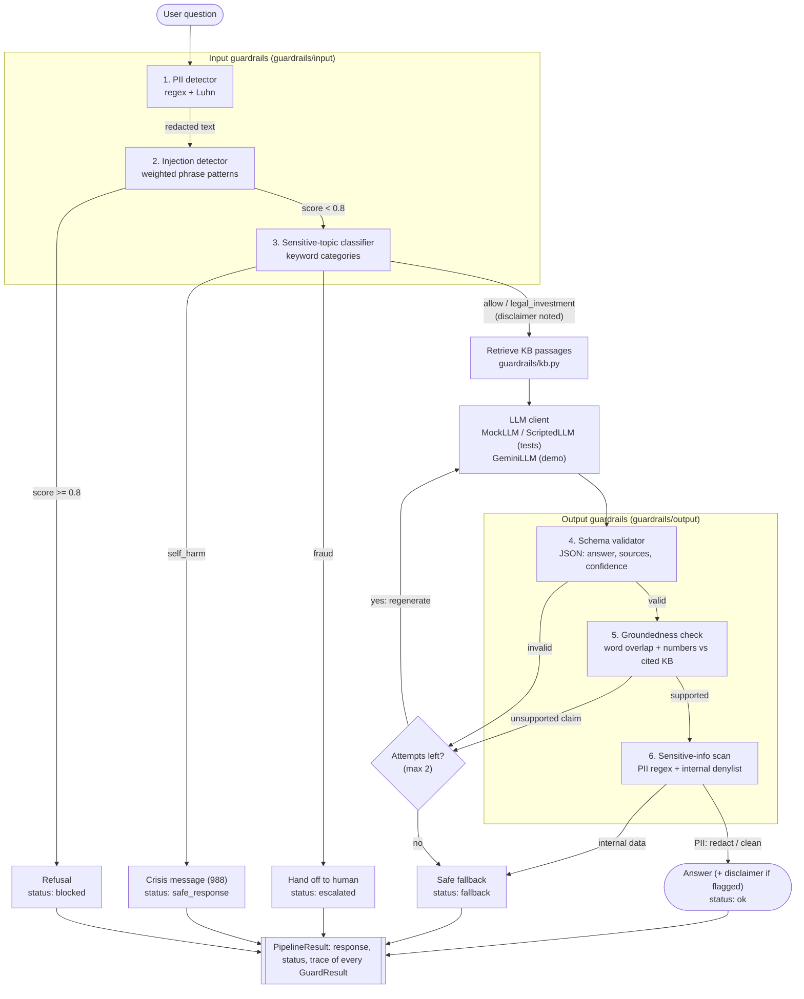

# Architecture

## Why each stage sits where it does

| Stage | Placement reason |
|---|---|
| PII first | Nothing downstream (logs, retrieval, the LLM provider) ever sees raw PII. |
| Injection before topic and LLM | Attacks are refused before any model call is spent. |
| Topic before LLM | Self-harm and fraud must never depend on what a model generates; they get fixed, reviewed responses. |
| Schema before groundedness | Groundedness needs the parsed `answer` and `sources` fields. |
| Groundedness before sensitive info | An unsupported answer is regenerated anyway, so scanning it is wasted work. |
| Sensitive info last | It checks the exact text the user will receive. Internal data goes straight to fallback with no retry, because a model that leaked once may leak again. |

Every guard returns the same `GuardResult(name, flagged, action, detail)` ([guardrails/result.py](../guardrails/result.py)), so the pipeline, tests and evaluation treat all six the same way.
